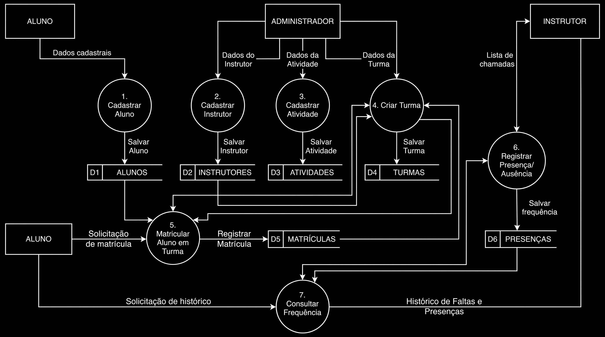
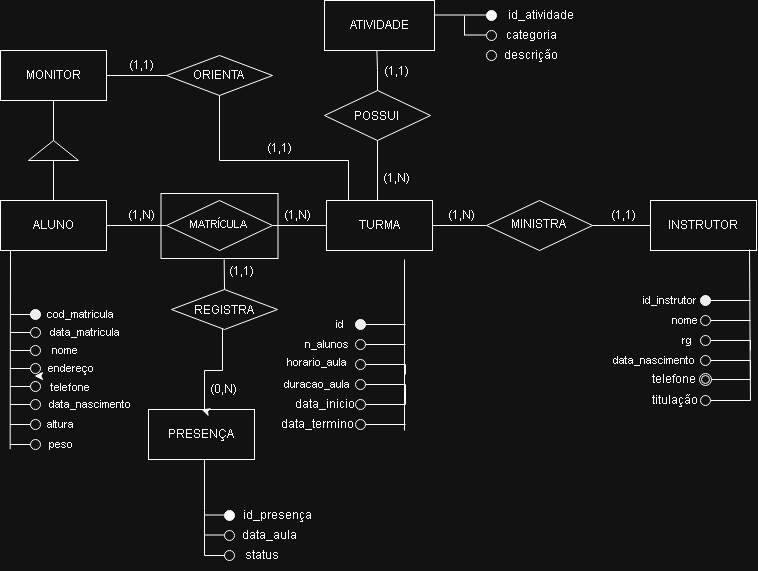
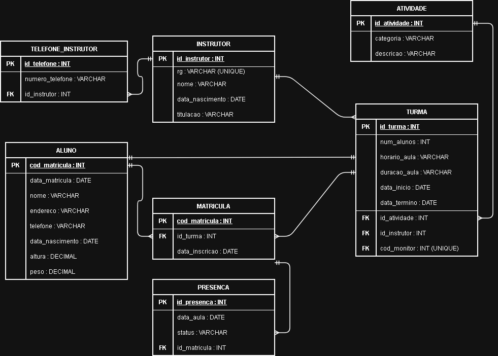

# Sistema de Gestão - Academia de Ginástica

> **Atividade Formativa de Engenharia de Software** — UniRuy Wyden
>
> **Professor:** Heleno Cardoso

Este repositório reúne os artefatos de análise, especificação, modelagem de dados, scripts SQL e prototipagem desenvolvidos para o sistema de controle de funcionamento de uma academia de ginástica.

## Sumário

* [1. Cenário e Levantamento de Requisitos](#1-cenário-e-levantamento-de-requisitos)
* [2. Requisitos Funcionais (RF)](#2-requisitos-funcionais-rf)
* [3. Regras de Negócio (RN)](#3-regras-de-negócio-rn)
* [4. Requisitos Não Funcionais (RNF)](#4-requisitos-não-funcionais-rnf)
* [5. Diagramas de Fluxo de Dados (DFD)](#5-diagramas-de-fluxo-de-dados-dfd)
* [6. Modelo Lógico](#6-modelo-lógico)
* [7. Modelo Físico (DER)](#7-modelo-físico-der)
* [8. Script SQL (DDL)](#8-script-sql-ddl)
* [9. Interface do Sistema e Prototipagem (Figma)](#9-interface-do-sistema-e-prototipagem-figma)

## 1. Cenário e Levantamento de Requisitos

O sistema da academia de ginástica deve gerenciar o cadastro de instrutores (com múltiplos telefones de contato), o cadastro de tipos de atividades, a criação e o gerenciamento de turmas (vinculadas a um único instrutor, uma atividade específica e um aluno monitor) e o cadastro de alunos.

Além disso, o sistema deve permitir que um aluno se matricule em múltiplas turmas, atualizando automaticamente a quantidade de alunos por turma, e manter um controle detalhado da frequência (presenças e ausências) de cada aluno por aula e por matrícula.

## 2. Requisitos Funcionais (RF)

* **RF01:** O sistema deve permitir cadastrar, consultar, alterar e excluir instrutores com RG, nome, data de nascimento, titulação e múltiplos telefones para contato.
* **RF02:** O sistema deve permitir cadastrar, consultar, alterar e excluir os tipos de atividades oferecidas pela academia.
* **RF03:** O sistema deve permitir criar e gerenciar turmas informando horário da aula, duração da aula, data de início, data de término, tipo de atividade e o instrutor responsável.
* **RF04:** O sistema deve permitir associar um instrutor a uma ou mais turmas.
* **RF05:** O sistema deve permitir associar um aluno monitor a cada turma.
* **RF06:** O sistema deve atualizar automaticamente o número de alunos matriculados na turma sempre que uma matrícula for realizada ou cancelada.
* **RF07:** O sistema deve permitir cadastrar, consultar, alterar e excluir alunos com código de matrícula, data de matrícula, nome, endereço, telefone, data de nascimento, altura e peso.
* **RF08:** O sistema deve permitir matricular um aluno em uma ou mais turmas específicas.
* **RF09:** O sistema deve permitir registrar a presença ou ausência dos alunos em cada aula realizada nas turmas em que estão matriculados.
* **RF10:** O sistema deve permitir consultar o histórico de frequência (presenças e ausências) de um aluno por turma e por período.

## 3. Regras de Negócio (RN)

* **RN01:** Cada turma deve estar associada a um único tipo de atividade e ser orientada por apenas um único instrutor.
* **RN02:** Um instrutor pode orientar várias turmas, inclusive de diferentes tipos de atividades.
* **RN03:** Toda turma deve possuir exatamente um aluno monitor, e um aluno pode exercer a função de monitor em, no máximo, uma turma.
* **RN04:** Um aluno pode estar matriculado em várias turmas simultaneamente, desde que deseje realizar atividades diferentes.
* **RN05:** O registro de frequência (ausências/presenças) é individualizado por matrícula e por data de aula, permitindo que um aluno tenha históricos distintos em cada turma que frequenta.
* **RN06:** Somente instrutores podem registrar faltas e consultar o histórico de frequência dos alunos de suas respectivas turmas.
* **RN07:** Instrutores têm acesso apenas aos dados dos alunos vinculados às suas próprias turmas, enquanto alunos têm permissão para visualizar apenas seus próprios dados cadastrais e de frequência.

## 4. Requisitos Não Funcionais (RNF)

* **RNF01 (Segurança e Privacidade):** O sistema deve estar em conformidade com a Lei Geral de Proteção de Dados (LGPD) para garantir a proteção dos dados pessoais e biométricos (altura/peso) de alunos e instrutores.
* **RNF02 (Controle de Acesso):** O sistema deve validar permissões de acesso por perfil de usuário (Administrador, Instrutor e Aluno).
* **RNF03 (Desempenho e Escalabilidade):** O sistema deve suportar até 10 vezes mais acessos simultâneos sem queda de performance durante os períodos de abertura de matrículas.
* **RNF04 (Usabilidade):** A interface deve ser intuitiva e de fácil operação para usuários com pouca familiaridade com tecnologia.
* **RNF05 (Disponibilidade):** O sistema deve operar em regime de alta disponibilidade, funcionando 24 horas por dia, 7 dias por semana (24/7).
* **RNF06 (Portabilidade / Responsividade):** A interface da aplicação deve ser responsiva, adaptando-se adequadamente a computadores, tablets e smartphones.

## 5. Diagramas de Fluxo de Dados (DFD)

Representação dos principais fluxos de informações do sistema orientados a eventos:



## 6. Modelo Conceitual

Design do Modelo Conceitual de Dados identificando entidades, atributos, relacionamentos, chaves e cardinalidades:



## 7. Modelo Lógico

Design do Modelo Lógico de Dados:




## 8. Script SQL (DDL)

Código SQL completo contendo a criação do banco de dados, tabelas, chaves primárias, chaves estrangeiras e restrições de integridade:

```sql
CREATE DATABASE academia_ginastica;
USE academia_ginastica;

CREATE TABLE Instrutor (
    id_instrutor INT PRIMARY KEY AUTO_INCREMENT NOT NULL,
    rg VARCHAR(20) UNIQUE NOT NULL,
    nome VARCHAR(100) NOT NULL,
    data_nascimento DATE NOT NULL,
    titulacao VARCHAR(100) NOT NULL
);

CREATE TABLE Telefone_Instrutor (
    id_telefone INT PRIMARY KEY AUTO_INCREMENT NOT NULL,
    numero_telefone VARCHAR(20) NOT NULL,
    id_instrutor INT NOT NULL,
    FOREIGN KEY (id_instrutor) REFERENCES Instrutor(id_instrutor) ON DELETE CASCADE
);

CREATE TABLE Atividade (
    id_atividade INT PRIMARY KEY AUTO_INCREMENT NOT NULL,
    categoria VARCHAR(50) NOT NULL,
    descricao VARCHAR(255) NOT NULL
);

CREATE TABLE Aluno (
    cod_matricula INT PRIMARY KEY AUTO_INCREMENT NOT NULL,
    data_matricula DATE NOT NULL,
    nome VARCHAR(100) NOT NULL,
    endereco VARCHAR(200) NOT NULL,
    telefone VARCHAR(20) NOT NULL,
    data_nascimento DATE NOT NULL,
    altura DECIMAL(3,2) NOT NULL,
    peso DECIMAL(5,2) NOT NULL
);

CREATE TABLE Turma (
    id_turma INT PRIMARY KEY AUTO_INCREMENT NOT NULL,
    num_alunos INT NOT NULL DEFAULT 0,
    horario_aula TIME NOT NULL,
    duracao_aula INT NOT NULL,
    data_inicio DATE NOT NULL,
    data_termino DATE NOT NULL,
    id_atividade INT NOT NULL,
    id_instrutor INT NOT NULL,
    cod_monitor INT UNIQUE NOT NULL,
    FOREIGN KEY (id_atividade) REFERENCES Atividade(id_atividade),
    FOREIGN KEY (id_instrutor) REFERENCES Instrutor(id_instrutor),
    FOREIGN KEY (cod_monitor) REFERENCES Aluno(cod_matricula)
);

CREATE TABLE Matricula (
    id_matricula INT PRIMARY KEY AUTO_INCREMENT NOT NULL,
    cod_matricula INT NOT NULL,
    id_turma INT NOT NULL,
    data_inscricao DATE NOT NULL,
    UNIQUE (cod_matricula, id_turma),
    FOREIGN KEY (cod_matricula) REFERENCES Aluno(cod_matricula),
    FOREIGN KEY (id_turma) REFERENCES Turma(id_turma)
);

CREATE TABLE Presenca (
    id_presenca INT PRIMARY KEY AUTO_INCREMENT NOT NULL,
    id_matricula INT NOT NULL,
    data_aula DATE NOT NULL,
    status ENUM('Presente', 'Ausente') NOT NULL,
    UNIQUE (id_matricula, data_aula),
    FOREIGN KEY (id_matricula) REFERENCES Matricula(id_matricula) ON DELETE CASCADE
);
```

## 9. Interface do Sistema e Prototipagem (Figma)

O fluxo de navegação, telas de cadastro, consultas e relatórios foram prototipados no Figma.

* **Link do Protótipo Interativo:** [Acessar Protótipo no Figma](COLE_AQUI_O_LINK_DO_SEU_FIGMA)

### Principais Telas

* **Telas de Cadastro:** Alunos, Instrutores, Atividades e Turmas.
* **Telas de Consulta / Operação:** Matrícula em Turmas e Controle de Frequência.
* **Relatórios:** Histórico de Frequência.
